<p align="center">
  
</p>

<h1 align="center">ClipPulse</h1>

<p align="center">
  Turn a long YouTube video into 9:16 Shorts — find the best moment, cut it, caption it, render it.<br>
  30s, 45s, 60s, or any length from 10–180 seconds. Locally, free, on your own machine.
</p>

<p align="center">
  
  
  
  
  
</p>

---

## What it makes

A vertical Short, cut from the strongest moment of a long video — not a random slice, not a re-upload.


Watch the full sample: **[examples/raj-clip-doac-spec.mp4](examples/raj-clip-doac-spec.mp4)** — 30 seconds from Raj Shamani's podcast with ex-Navy SEAL Robert J. O'Neill, the "super secret mission" moment (window 800–830s).

Every clip follows the same production standard:

- **Framing** — 16:9 source centre-cropped to 4:5, with the same frame scaled up and blurred behind it as top/bottom bars. Wide two-shots fall back to a 16:9 letterbox so no face is ever half-cut.
- **Hook title** — a big yellow title for the first 2.8 seconds, stating the payoff before the story starts.
- **Captions** — word-by-word karaoke, ALL CAPS, current word yellow / rest white, placed **below the picture** on the bottom bar — never over a face.
- **Voice** — cleaned and levelled to −14 LUFS, natural pauses kept.
- **No music. No sound effects.** The professional look comes from framing, the title and the captions — not from decoration.

One honest line: ClipPulse finds the strongest moments it can *measure*. It cannot guarantee views — no tool can.

## Caption styles

Eighteen styles, eighteen different videos. Each preview below is a
looping GIF from the full 30-second clip — it plays by itself, no need to
press play. The full clip is linked under it. Every style was rendered
from its own real YouTube moment and verified frame by frame; the full
index is in [examples/styles/README.md](examples/styles/README.md).

> **v8.9 (2026-11-17):** the gallery now shows all **18 caption styles**,
> each from a different video — no more "same clip, seven ways". `doac`
> was retired from the app in v8.8 (its folder stays here as history).

| Style | Preview (plays by itself) | Full clip |
|---|---|---|
| **Hormozi V1** — Anton 72pt, red current word, ALL CAPS, word pop (Boxing) | 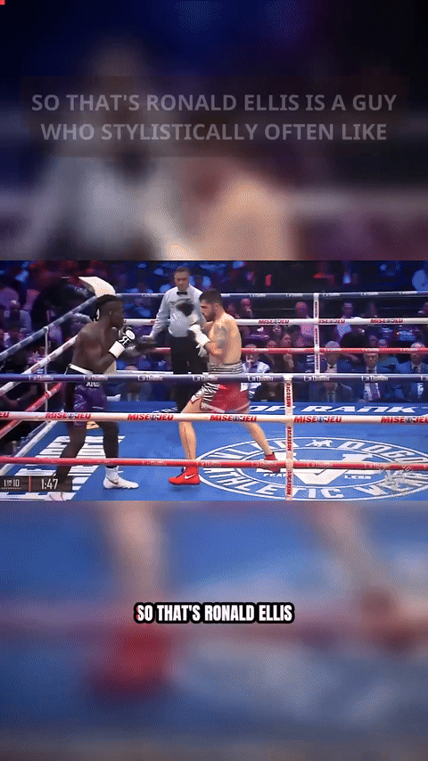 | [hormozi-v1/clip.mp4](examples/styles/hormozi-v1/clip.mp4) |
| **Red Line** — Anton 68pt, rose wordbox following the word (Boxing) | 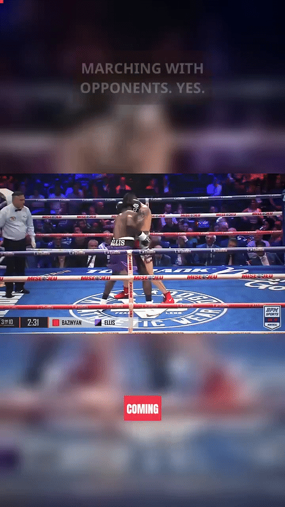 | [red-line/clip.mp4](examples/styles/red-line/clip.mp4) |
| **Undercut** — Playfair Display Italic 58pt, yellow, sweeping in (Apex) | 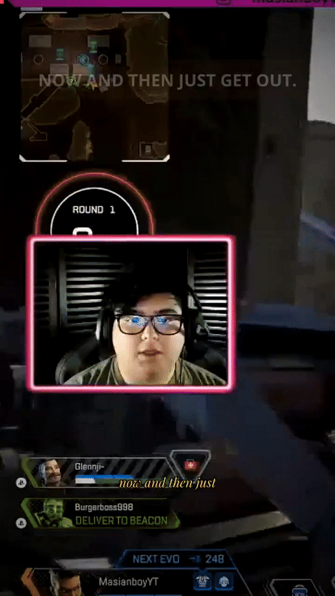 | [undercut/clip.mp4](examples/styles/undercut/clip.mp4) |
| **Streamline** — Anton 68pt, purple wordbox sliding in (Boxing) | 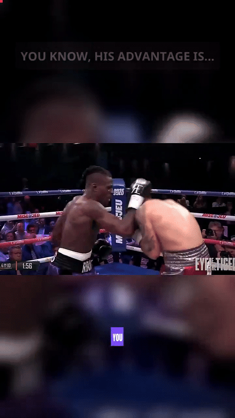 | [streamline/clip.mp4](examples/styles/streamline/clip.mp4) |
| **Hormozi Short 2026-A** — Bebas Neue 64pt, white, slide-up (Apex) | 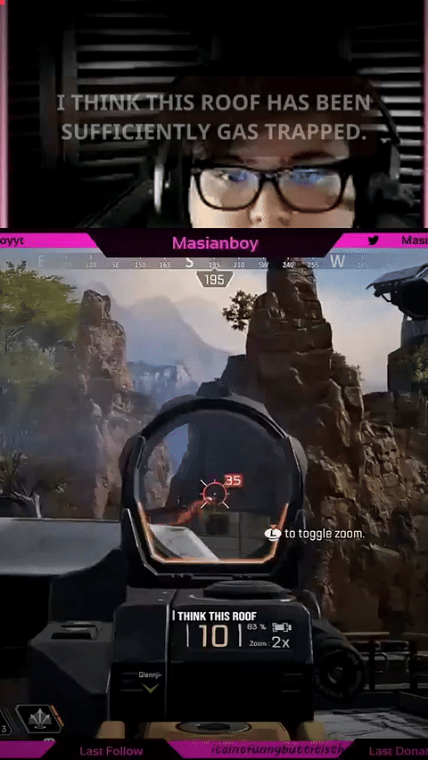 | [hormozi-2026-a/clip.mp4](examples/styles/hormozi-2026-a/clip.mp4) |
| **Hormozi Short 2026-B** — Anton 72pt, amber glow, pulse (Raj) | 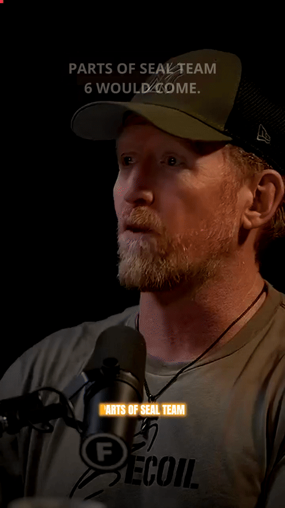 | [hormozi-2026-b/clip.mp4](examples/styles/hormozi-2026-b/clip.mp4) |
| **Hormozi Short 2026-C** — Montserrat ExtraBold 40pt, teal, fade (Boxing) | 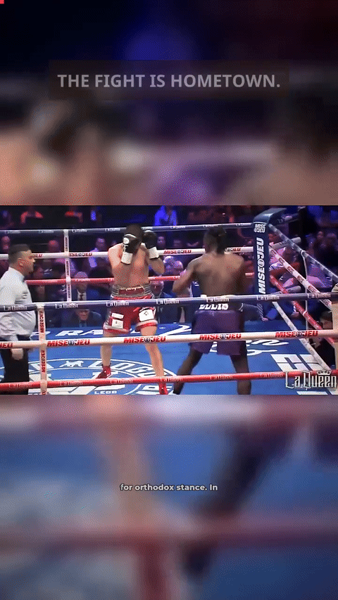 | [hormozi-2026-c/clip.mp4](examples/styles/hormozi-2026-c/clip.mp4) |
| **Hormozi Short 2026-D** — Bebas Neue 110pt, blue, one huge word at a time, centre frame (Apex) | 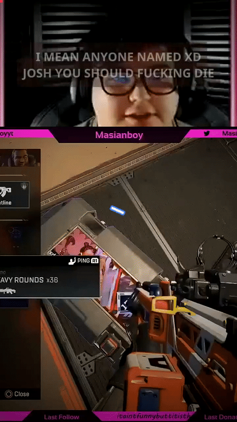 | [hormozi-2026-d/clip.mp4](examples/styles/hormozi-2026-d/clip.mp4) |
| **Hormozi Short 2026-E** — Anton 72pt, light-green glow, pulse-glow (Raj) | 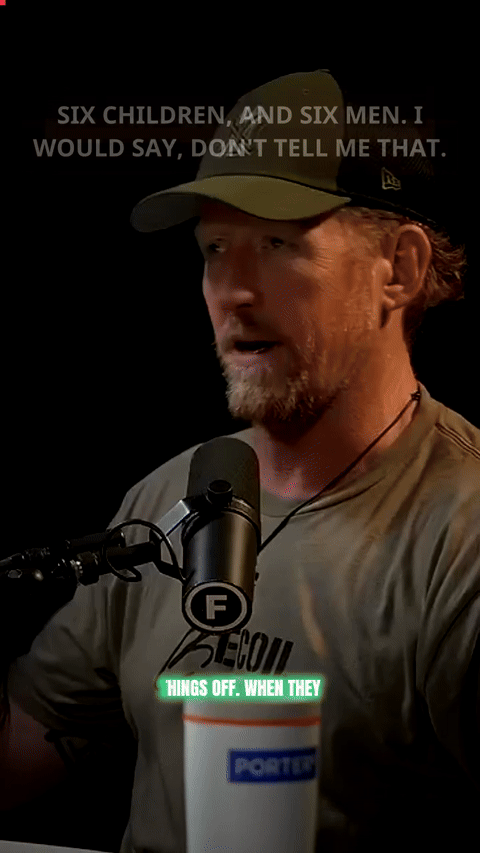 | [hormozi-2026-e/clip.mp4](examples/styles/hormozi-2026-e/clip.mp4) |
| **MrBeast** — Anton 76pt, orange, pop-big (MrBeast) | 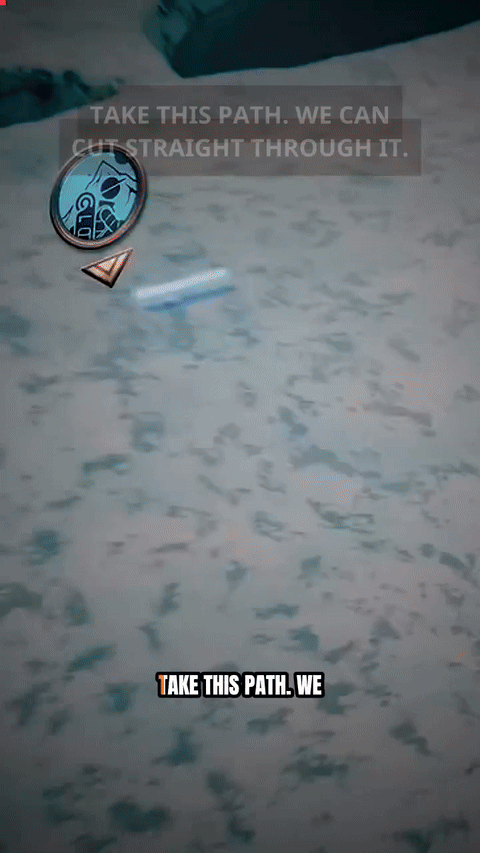 | [mrbeast/clip.mp4](examples/styles/mrbeast/clip.mp4) |
| **Iman-A** — Montserrat 56pt, slate, slide-down (Raj) | 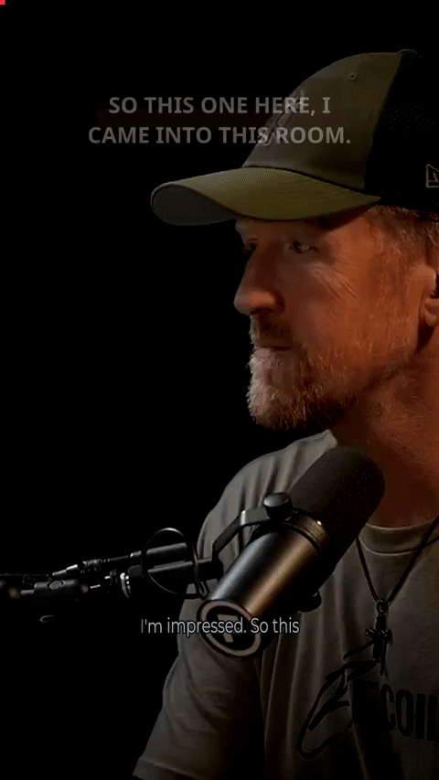 | [iman-a/clip.mp4](examples/styles/iman-a/clip.mp4) |
| **Cardone-A** — Anton 72pt, maroon outline, bounce (Cricket) | 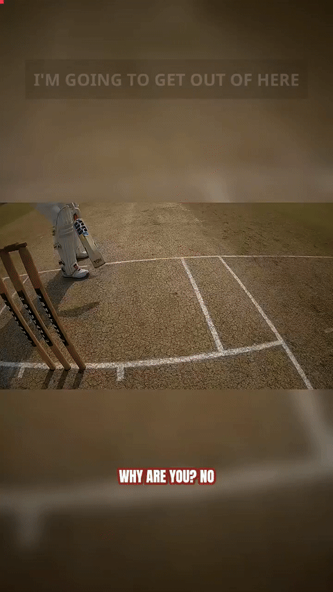 | [cardone-a/clip.mp4](examples/styles/cardone-a/clip.mp4) |
| **Hollywood Fill** — Anton 72pt, navy outline, flip (Apex) | 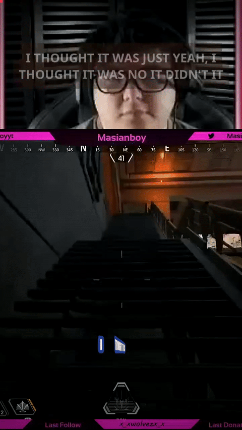 | [hollywood-fill/clip.mp4](examples/styles/hollywood-fill/clip.mp4) |
| **Roman** — Anton 68pt, burnt-orange wordbox, flip (MrBeast) | 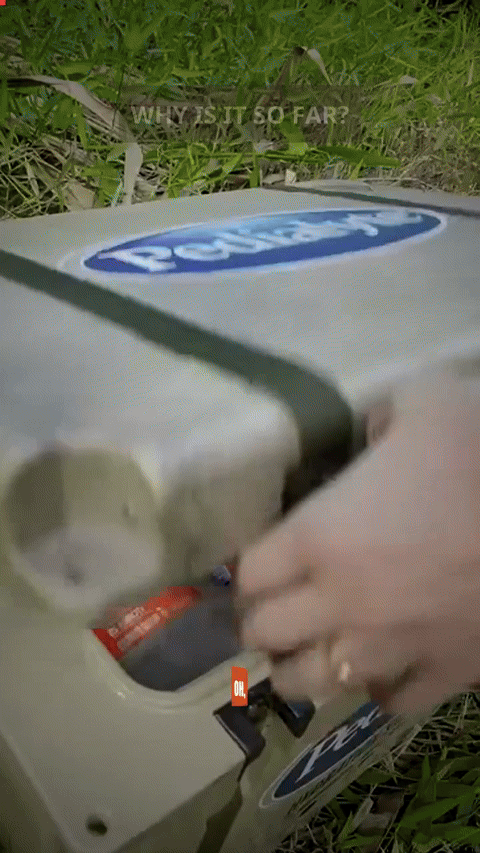 | [roman/clip.mp4](examples/styles/roman/clip.mp4) |
| **SARA** — Poppins ExtraBold 66pt, pink glow, bounce-soft (Raj) | 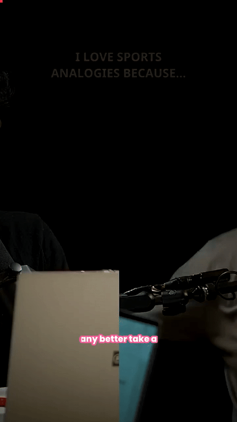 | [sara/clip.mp4](examples/styles/sara/clip.mp4) |
| **ALI** — Montserrat 48pt, grey line-box, typewriter (Cricket) | 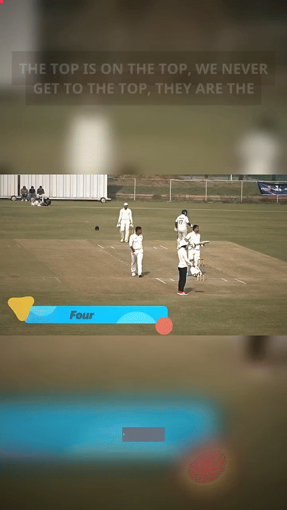 | [ali/clip.mp4](examples/styles/ali/clip.mp4) |
| **Axel** — Poppins ExtraBold 60pt, dark-green wordbox, zoom (MrBeast) | 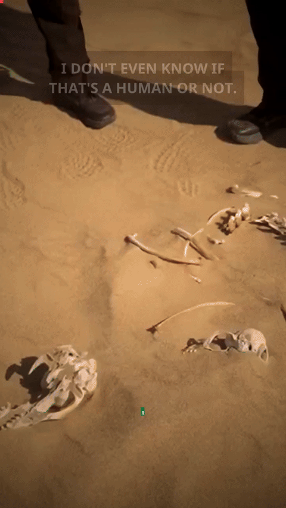 | [axel/clip.mp4](examples/styles/axel/clip.mp4) |
| **YELLOW BURST** — Anton 72pt, pale-yellow text on a near-black box, rise (Cricket) | 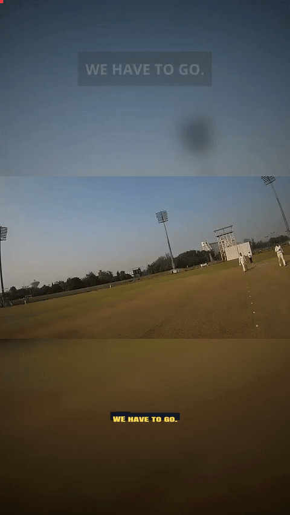 | [yellow-burst/clip.mp4](examples/styles/yellow-burst/clip.mp4) |

## How it works


1. **Paste a link, or fetch trends** — any YouTube link (watch, youtu.be, Shorts, live, embed, or a bare video ID), or the trending long videos of 10 default creators, re-sorted by real view count.
2. **Smart analyze** — the full video is transcribed with real Whisper speech-to-text, and a real audio-energy profile is measured. A sliding window scores every moment at your chosen clip length (30s by default) on hook strength, payoff, emotion and audio peaks.
3. **4 clips, scored** — the top 4 non-overlapping moments, each with a suggested title and hook. Preview each one in the page.
4. **Render & download** — local MP4 via ffmpeg in 720p, 1080p or 4K, with your chosen caption style (18 styles) and burned-in captions.

## Screenshots

The real app, running at `http://localhost:3000` — fresh shots of every tab, taken Nov 17, 2026.

**Workbench** — paste a link or pick a CC-BY source, analyze, and the 4 best 60s clips are scored and ready.

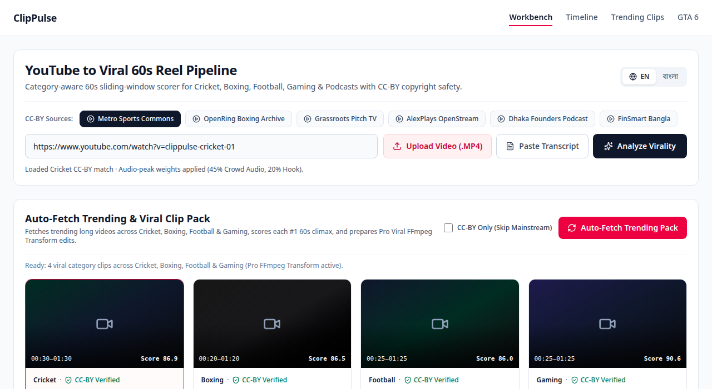

**Timeline** — the 60s sliding-window virality timeline with the 9:16 reel preview beside it.

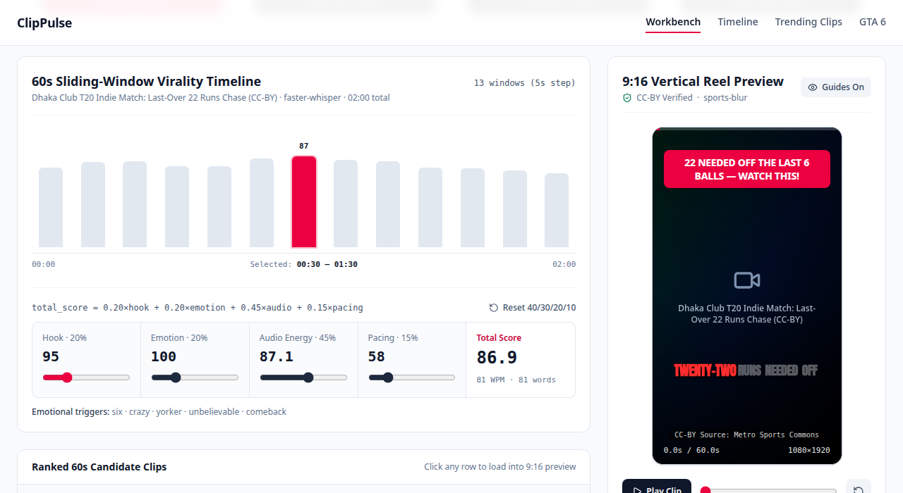

**Trending Clips** — one click fetches the 10 default creators, re-sorted by real view count.


**GTA 6** — Vice City–themed countdown to the Nov 19, 2026 launch, then the biggest gameplay channels.

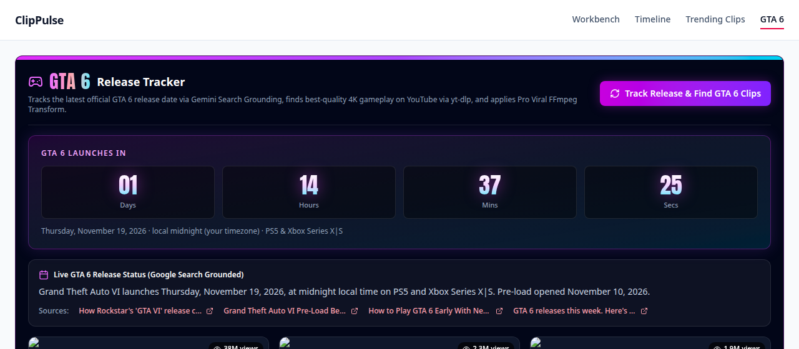

## 🎮 GTA 6 Tab — countdown to launch, then clip the biggest gameplay

**Grand Theft Auto VI launches Thursday, November 19, 2026** — midnight local time, PS5 and Xbox Series X|S. The GTA 6 tab is a dedicated Vice City–themed space for it: dark background, neon pink-purple-cyan sunset, glowing countdown digits. (Screenshot in the gallery above.)

1. **Countdown** — live ticking days / hours / minutes / seconds to local midnight Nov 19.
2. **Launch flips it LIVE** — the countdown stops, a glowing LIVE badge appears, and the tab auto-loads the biggest GTA 6 gameplay on YouTube.
3. **Thumbnail grid** — the biggest channels streaming and posting GTA 6 gameplay, ranked by real view count, with thumbnails and view-count chips. No fake data — live yt-dlp search, refreshed on demand.
4. **Click any card to clip it** — the video loads straight into the Workbench, ready to cut into Shorts.

Checked Nov 17, 2026 — what the live grid looked like two days before launch (the live tab always shows the current top videos; this table is a snapshot):

| Channel | Video | Views |
|---|---|---|
| Rockstar Games | Grand Theft Auto VI: An Extended Look | 37.9M |
| Hollow | New GTA 6 Gameplay Just Blew Everyones Mind.. | 2.3M |
| GameCheck | GTA 6 Official Gameplay Trailer (2026) | 913K |
| Hollow | New GTA 6 Photorealistic Gameplay Just Dropped.. | 550K |
| TmarTn2 | GTA 6 - Everything You Need to Know | 449K |
| TmarTn2 | New GTA 6 Gameplay Looks Absolutely Unreal | 428K |

## Features

- **Smart analyze** — full-video Groq Whisper transcription + real audio-energy profile + sliding-window virality scoring (no preset transcripts, no fake scores)
- **18 caption styles** — each with its own font, accent colour, highlight and motion; no two alike (see the gallery above). Font size, colour and caption position are adjustable per render
- **GTA 6 tab** — Vice City–themed countdown to the Nov 19, 2026 launch, then a live grid of the biggest GTA 6 gameplay channels; click any card to clip it
- **Trending fetch** — 10 default creators (MrBeast, IShowSpeed, Kai Cenat, Raj Shamani, Joe Rogan, PewDiePie, Markiplier, Airrack, Dude Perfect, Dream), 1-hour cache
- **Paste-a-link** — validated YouTube URLs only; anything else is rejected, not guessed at
- **Scene-aware editing** — PySceneDetect cuts, smooth face tracking, per-scene framing decisions
- **720p / 1080p / 4K** — 4K renders take ~10 minutes per clip on a modest machine; 720p takes about a minute
- **Voice polish** — high-pass, presence EQ, de-esser and loudness normalisation on every render

## Quickstart

**One command — install + start** (Mac, Linux, or Git Bash on Windows).
Age sudhu [Node.js LTS](https://nodejs.org) ar [Git](https://git-scm.com) install kore nao:

```bash
curl -fsSL https://raw.githubusercontent.com/Manik51/Clippulse/main/scripts/install.sh | bash
```

Eta repo download kore, setup chalaye (Node package, ffmpeg, yt-dlp, face model, font), ar server start kore dey. Tarpor kholo **http://localhost:3000**. Bondho korte terminal-e `Ctrl+C`.

**Hate kore korte chaile** (eko-i jinish, 4 step-e):

```bash
git clone https://github.com/Manik51/Clippulse.git
cd Clippulse

# One-time setup: copies .env.example → .env, installs deps, ffmpeg & yt-dlp
bash scripts/setup-local.sh

# Add your free API keys to .env (see below), then:
npm run prod
```

Open **http://localhost:3000**.

### API keys (`.env`)

| Variable | Required? | Free source | What it unlocks |
|---|---|---|---|
| `GEMINI_API_KEY` | Recommended | [Google AI Studio](https://aistudio.google.com/apikey) | AI hook scoring & titles |
| `GROQ_API_KEY` | Recommended | [Groq Console](https://console.groq.com/keys) | Fast Whisper transcription & GPT-OSS-120B scoring |
| `YOUTUBE_API_KEY` | Not required | — | ClipPulse uses `yt-dlp` zero-key search when this is omitted |

Keys live only in your local `.env` — never committed, never sent anywhere except the provider APIs above.

### Tests

```bash
npm test   # 35 tests, virality scoring + subtitle + layout logic
npm run lint
```

## The DOAC production standard (retired in v8.8 — history)

The clip style was not guessed. It was measured, frame by frame, from a Diary of a CEO Short ("A Soviet Grocery Store Had Only 77 Items"), then built as one sample, checked shot by shot, and approved before it became the standard. In v8.8 the owner released it ("doac ta lagbe na") and the app moved to 18 reference caption styles with Hormozi V1 as the default. The spec below is kept as the history of that standard; the sample clip stays in `examples/`.

| Element | Spec |
|---|---|
| Format | 9:16, 720×1280, 30 fps |
| Framing | 16:9 → 4:5 centre crop, blurred-fill bars; wide two-shots → 16:9 letterbox |
| Cuts | Hard cuts only, from the source's own cameras — no transitions, no zoom inside a shot |
| Hook title | Big yellow title, first ~2.8 s, payoff first |
| Captions | Word-by-word, ALL CAPS, below the picture on the bottom bar; current word yellow, rest white |
| Voice | Clean, natural, pauses kept, levelled to −14 LUFS |
| Music / SFX | None |

## Security

ClipPulse is a **local-only tool with no authentication**. Run it on your own machine and keep it there — do not expose port 3000 to the internet, and do not put it behind a public tunnel. Pasted URLs are validated (only real youtube.com / youtu.be links are accepted). API keys stay in your local `.env` (chmod 600); `.env` is git-ignored and the repo ships only `.env.example` with placeholders.

## Project structure

```
clippulse/
├── server.ts               # Express API: analyze, render, trending, jobs
├── src/
│   ├── lib/virality.ts     # Scoring, captions (18 styles), layout & timing
│   └── components/         # ReelPreviewPanel, TrendingClipsPanel, TopBar
├── scripts/                # PySceneDetect, YuNet face detection, thumbnails
├── requirements.txt        # Python dependencies (OpenCV, PySceneDetect, Pillow)
├── assets/                 # Logo (SVG + PNG), flow diagram, demo GIF, screenshots, how-to visual
├── examples/               # DOAC sample clip (history) + caption-style showcases (v8.7 set; v8.8 18-style refresh pending)
├── renders/                # Your rendered clips (git-ignored)
└── PRODUCTION-READY.md     # Full build history, v1 → v8.8
```

## Roadmap

- **Next:** faster-whisper word timestamps, run locally on the chosen 30-second clip only — real word timings for the karaoke captions, no cloud quota
- **Later:** silence-trimmed leading cuts, pop SFX on word hits (optional, off by default in DOAC style)

## License

MIT — see [LICENSE](LICENSE).
